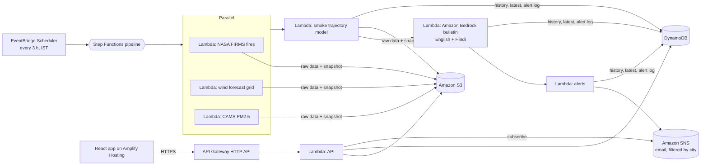

# SmokeSignal

**Know when farm-fire smoke will reach your city, and which fires it is coming from.**

Built for **Environmental Hacks (Bharat Builds Tour, WeMakeDevs × AWS), Track 01: Air.**

Every October and November, smoke from crop-residue fires in Punjab and Haryana drifts across North India. People find out when the sky is already grey. SmokeSignal turns satellite fire detections and wind forecasts into a city-by-city early warning:

- **When:** "Heavy smoke reaches Delhi in about 8 hours, heaviest between 02:30 and 08:30."
- **From where:** "20% from fires near Sangrur, 19% near Mansa…"
- **What to act on first:** fire areas ranked by how much smoke they send towards people in the next 24 hours, so enforcement and residue-management teams can go where it matters most today.
- **Who gets told:** a short English + Hindi bulletin ready to forward, and email alerts to subscribers before the smoke arrives.
- **Replay:** re-run any past day from the archives (for example a bad November day) to see how SmokeSignal would have warned each city.

It covers 17 cities: Delhi NCR, Chandigarh, Dehradun, Jaipur, Agra, Kanpur and Lucknow downwind, the Punjab and Haryana cities inside the burning belt (Amritsar, Jalandhar, Ludhiana, Patiala, Bathinda, Hisar, Panipat), and Meerut. Fires across the border in Pakistani Punjab are counted as smoke sources, because their smoke reaches Amritsar and Delhi on west winds, but only fires in India are ranked in "fires to act on first".

**Live app:** LIVE_APP_URL

---

## How it works



**The model** (`backend/src/lib/smoke.mjs`, unit-tested):

1. Fetch the last 24 h of VIIRS fire detections from NASA FIRMS over Punjab, Haryana, west UP, north Rajasthan and the Pakistani Punjab border belt.
2. Group them into ~10 km clusters weighted by fire radiative power (FRP), a standard proxy for smoke output.
3. Release smoke parcels from each cluster now, +3 h and +6 h, and move them with the 48-hour wind forecast at 925 hPa (about 500 m above the plains, where smoke travels). This uses bilinear interpolation in space, linear in time, and 2nd-order Runge-Kutta with 10-minute steps.
4. Smoke weakens with age (36 h e-folding). A parcel passing within 35 km of a city counts as arriving there.
5. Per city, compute the **ETA** (when 10% of the expected smoke load has arrived), the **peak 6-hour window**, the **smoke level** (light, moderate or heavy, by arriving FRP-weight), and the **source areas**.
6. Rank fire areas by people-weighted smoke delivered (city population, Census 2011) in the next 24 h.

This is a simplified Lagrangian trajectory model: the same idea as NOAA HYSPLIT trajectories, without dispersion or vertical motion. It estimates **when and from where** smoke arrives, not PM2.5 concentrations. The CAMS PM2.5 forecast is shown alongside as an independent check.

## Case study: 11 November 2025

We replayed the evening of 11 November 2025 (`REPLAY_DATE=2025-11-11`) using only data that existed at the time: 836 archived NASA VIIRS fire detections and the wind forecast issued that day.

- SmokeSignal flags **heavy farm-fire smoke reaching Delhi in about 6 hours** (overnight), mostly from fires near Muktsar, Sangrur and Moga, with Panipat, Noida and Gurugram also heavy.
- What happened: Delhi's AQI was 428 on 11 November, the season's first "severe" day, and 418 the next day. On 12 November the Decision Support System attributed **22.4% of Delhi's PM2.5 to stubble burning**, the highest share that winter ([Outlook Business, 13 Nov 2025](https://www.outlookbusiness.com/news/delhi-toxic-smog-crop-burning-surge-air-quality)).

One day is a consistency check, not a validation; the next step is to replay every day of the 2024 and 2025 seasons against CPCB station data.

## AWS services and why

| Service | Job in SmokeSignal |
|---|---|
| **AWS SAM** (open source) | Whole backend as code. One `sam deploy` creates everything below. |
| **AWS Step Functions** | Runs the pipeline: three fetches in parallel → simulate → bulletin → alerts, with retries. |
| **Amazon EventBridge Scheduler** | Starts the pipeline every 3 hours (Asia/Kolkata time zone). |
| **AWS Lambda** (Node.js 22, arm64) | Seven functions: three fetchers, simulation, bulletin, alerts, API. |
| **Amazon Bedrock** (Amazon Nova Lite) | Writes the English + Hindi bulletin from the computed numbers only. Falls back to a template if unavailable (our new Free-plan account currently gets "Operation not allowed" from Bedrock, so the deployed app shows the template). |
| **Amazon S3** | Raw inputs and forecast snapshots per run (expire after 14 days). |
| **Amazon DynamoDB** | Latest pointer, per-city history, alert log (12 h cooldown), subscribers. Single-table design with TTL. |
| **Amazon SNS** | Email alerts. One topic; each subscription has a filter policy so people only get their city. |
| **Amazon API Gateway** (HTTP API) | Public API with CORS and throttling. |
| **AWS Amplify Hosting** | Hosts the React app from GitHub. |
| **AWS X-Ray + CloudWatch** | Traces across Step Functions and Lambda; structured logs per step. |

## Repository layout

```
backend/
  template.yaml              AWS SAM template (all infrastructure)
  statemachine/pipeline.asl.json
  src/lib/smoke.mjs          the smoke-transport engine (pure, tested)
  src/lib/firms.mjs          NASA FIRMS client + CSV parsing
  src/lib/openmeteo.mjs      wind grid + CAMS air quality client
  src/lib/snapshot.mjs       builds the forecast snapshot the app shows
  src/lib/bulletin-text.mjs  Bedrock prompt + template fallback
  src/lib/alerts.mjs         alert rules and email text
  src/handlers/*.mjs         Lambda handlers
  test/smoke.test.mjs        unit tests (node --test)
  scripts/run-local.mjs      run the whole pipeline locally with real data
  scripts/make-mock.mjs      synthetic data for frontend development
frontend/                    React + Vite app (map drawn with canvas + SVG, no map library)
docs/api.md                  API reference
amplify.yml                  Amplify Hosting build settings
```

## Run it

### 0. Prerequisites
Node.js 22, AWS CLI (configured), AWS SAM CLI, and a free [NASA FIRMS MAP_KEY](https://firms.modaps.eosdis.nasa.gov/api/map_key/).

### 1. Test the engine
```bash
cd backend
npm test
```

### 2. Run with real data on your laptop (no AWS needed)
```bash
cd backend
FIRMS_MAP_KEY=your_key npm run local     # writes frontend/public/local-latest.json
cd ../frontend
npm install
npm run dev                              # opens the app on the real forecast
```
Windows PowerShell: set the key with `$env:FIRMS_MAP_KEY="your_key"` and then run `npm run local`.
Without `local-latest.json` or `VITE_API_URL`, the app uses synthetic sample data and shows a banner saying so.

### 2b. Replay a past smoke day
```bash
cd backend
FIRMS_MAP_KEY=your_key REPLAY_DATE=2025-11-11 npm run local    # writes frontend/public/replay.json
```
Windows PowerShell: `$env:REPLAY_DATE="2025-11-11"; npm run local` (then `Remove-Item Env:REPLAY_DATE` to go back to live).

It uses archived NASA FIRMS fire detections and the wind forecast that was issued that day (Open-Meteo Historical Forecast API), and starts at 17:00 IST, after the afternoon satellite pass (`REPLAY_HOUR_IST` to change). Commit `frontend/public/replay.json` and the deployed app shows a **Live forecast / Replay** switch, with a banner saying the replay is not today's forecast.

### 3. Deploy the backend (region ap-south-1, Mumbai)
In the Bedrock console (us-east-1), open the playground and run one prompt on **Amazon Nova Lite** to confirm your account can use it. Then:
```bash
cd backend
sam build
sam deploy --parameter-overrides FirmsMapKey=YOUR_FIRMS_KEY AdminKey=pick-a-long-random-string
```
The output `ApiUrl` is your API. Run the pipeline once right away:
```bash
curl -X POST "$API_URL/run" -H "x-admin-key: pick-a-long-random-string"
```
Windows PowerShell:
```powershell
Invoke-RestMethod -Method Post -Uri "$API_URL/run" -Headers @{ "x-admin-key" = "pick-a-long-random-string" }
```
Or use **Start execution** in the Step Functions console. After about 1–2 minutes, `curl "$API_URL/latest"` returns the forecast.

To use Bedrock in another region or with another model, pass `BedrockRegion=... BedrockModelId=...` (for example an inference profile ID such as `apac.amazon.nova-lite-v1:0` for Mumbai).

### 4. Deploy the frontend (Amplify Hosting)
1. Push this repo to GitHub.
2. In the Amplify console, choose **Create new app**, then **GitHub**, pick the repo, and tick **My app is a monorepo** with root `frontend`.
3. Add environment variables `VITE_API_URL` (the `ApiUrl` above) and `AMPLIFY_MONOREPO_APP_ROOT` = `frontend`. Build settings come from `amplify.yml`.
4. Once it is live, redeploy the backend with `AppUrl=https://your-app.amplifyapp.com` so alert emails link to the map.

### 5. Try an alert
Subscribe with your email in the app, click **Confirm subscription** in the email from AWS, then run the pipeline. If moderate or heavy smoke is due in your city within 24 h, the alert arrives within a minute.

### 5b. Send a labelled test alert from the replay
Real alerts only go out when moderate or heavy smoke is due within 24 hours. To see what one looks like on a quiet day, send a test alert built from the replay. Its subject and first line say **TEST, replay of 2025-11-11**, and it does not affect the real 12-hour cooldown. Run from the repo root in PowerShell:
```powershell
$BUCKET = aws cloudformation describe-stacks --stack-name smokesignal --query "Stacks[0].Outputs[?OutputKey=='DataBucketName'].OutputValue" --output text
aws s3 cp frontend\public\replay.json "s3://$BUCKET/replay/replay.json"
$FN = aws cloudformation describe-stack-resource --stack-name smokesignal --logical-resource-id NotifyFunction --query "StackResourceDetail.PhysicalResourceId" --output text
Set-Content "$env:TEMP\payload.json" '{"snapshotKey":"replay/replay.json","test":true,"cities":["delhi"]}'
aws lambda invoke --function-name $FN --payload "file://$env:TEMP\payload.json" "$env:TEMP\out.json"; Get-Content "$env:TEMP\out.json"
```

### Cost (built to run free)
Everything is serverless and scales to zero. On a new AWS account on the **Free plan**:
- Lambda, Step Functions (4,000 transitions/month), DynamoDB, SNS email (1,000/month), EventBridge Scheduler, CloudWatch and X-Ray stay inside their always-free limits at one run every 3 hours.
- S3, API Gateway, Amplify Hosting and Bedrock (Nova Lite) cost cents a month, which the free credits cover.

Set up a zero-spend AWS Budget anyway. When you are done, `sam delete` removes everything.

## API

See [docs/api.md](docs/api.md). `GET /latest`, `GET /cities`, `GET /history?city=delhi`, `POST /subscribe`, `POST /run` (admin).

## Limitations

- Smoke arrival is a **trajectory estimate**, not a measured concentration. There is no plume rise, dispersion or chemistry. Levels are relative thresholds on fire-power arriving, documented in `smoke.mjs`.
- VIIRS sees fires at satellite overpasses (around 01:30 and 13:30 local time), and misses fires under thick cloud or smoke.
- Wind is a single level (925 hPa by default, configurable). Night-time inversions trap smoke near the ground in ways one level cannot capture.
- City populations are Census 2011 figures, used only to rank fire areas.
- Smoke levels are thresholds on arriving fire power, expressed in typical farm fires (light: a few fires' worth of smoke; moderate: 10-30; heavy: 50-100+). They are not calibrated against measured PM2.5.
- No validation against ground monitors yet. Next step: compare ETAs with CPCB station PM2.5 rises over the season.

## Team

| Member | GitHub |
|---|---|
| Ashish Kumar Yadav (team leader) | [@AshishYadav0704](https://github.com/AshishYadav0704) |
| Sahil Kumar Singh | [@Sahilgggg](https://github.com/Sahilgggg) |
| Sonu Kumar | [@sonukumar8789217](https://github.com/sonukumar8789217) |
| Umang Yadav | [@umang-yadav-123](https://github.com/umang-yadav-123) |

## Data and credits

- Fire data: NASA FIRMS (Fire Information for Resource Management System), part of NASA's Earth Science Data and Information System.
- Weather data by [Open-Meteo.com](https://open-meteo.com/) (CC BY 4.0).
- Air-quality forecast: contains modified Copernicus Atmosphere Monitoring Service (CAMS) information, via Open-Meteo.
- Typeface: Anek by Ek Type (SIL Open Font License), via Google Fonts.

## License

MIT
